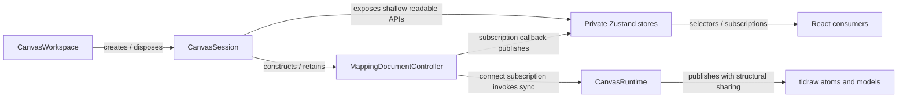

# Architectural interpretation and review priorities

These notes distinguish direct source inspection from interpretation. The generated
[whole-repository report](architecture-whole-repository.md) supplies the graph counts,
partition scores, uncertainties and persisted evidence for its pinned snapshot.
This page does not substitute code examples for measured whole-program accuracy.

## The inspected subsystem

This diagram is a source-inspected explanation of the mandatory real-source seeds,
not an automatically inferred execution trace. Arrows have explicit meanings;
containment, lifecycle and reactive edges remain distinct in the persisted graph.

The source links below identify the wiring and its limitations.

## The workspace/session boundary is a real lifecycle boundary

`CanvasWorkspace.setDrafts` constructs sessions for incoming document seeds, reuses
unchanged draft objects, and disposes replaced sessions. It also maintains the
controller registry and subscription handles. This makes the workspace a plausible
lifecycle owner even though TypeScript does not enforce exclusive ownership.
See [the workspace implementation](../../src/features/mapping/workspace/canvasWorkspace.ts#L60).

`CanvasSession` constructs a controller and several private Zustand stores. The
public fields expose `readable(...)` facades, while the constructor's controller
subscription publishes changes through private setters. The facade omits mutation
methods; it does not freeze objects returned by `getState()`. Both facts matter:
there is an intentional API boundary, and it is shallow.
See [readable](../../src/features/mapping/workspace/canvasSession.ts#L12) and
[the constructor](../../src/features/mapping/workspace/canvasSession.ts#L47).

**Interpretation:** allocation, retention, subscription and disposal evidence agree
on this boundary better than a file import graph alone would show. The analyzer's
allocation-site and declaration-slot abstraction cannot prove that every runtime
instance is disposed. A useful next dynamic check is repeated open/replace/close
cycles while measuring live sessions and listeners.

## The renderer boundary carries deliberate reactive coupling

`CanvasRuntime` translates controller snapshots into tldraw atoms and view models.
`Models.publish` and `shareEqual` preserve equal branches so consumers can avoid
unnecessary reactive changes. The controller and renderer therefore interact across
source directories through subscriptions and model publication, even when both
ends belong to one architectural layer.
See [runtime projection and structural sharing](../../src/features/mapping/tldraw/CanvasRuntimeContext.tsx#L25).

**Interpretation:** a cross-directory edge here is expected wiring. Review whether
changes publish only the relevant models before treating a high static edge count
as excessive coupling. Static counts cannot establish update frequency, rendering
cost, or whether an atom's value actually changes.

## A capture/dependency mismatch can be intentional

The first effect in `CursorCopyOverlay` declares `[session, stage]`, while its
handlers also capture refs such as `latest` and `pointer`. The component updates
`latest.current` during rendering, and the handlers consult that ref. The effect
also returns cleanup that removes the listeners it installed.
See [the effect and its handlers](../../src/features/mapping/canvas/CursorCopyOverlay.tsx#L22).

**Interpretation:** comparing lexical captures with effect dependencies exposes the
pattern, but does not establish a missing-dependency bug. A stale-closure review
must distinguish stable ref identity from the values read through `.current`, and
check the intended listener lifetime.

## How to use the scores

Directory cohesion answers whether dependencies stay in their directory groups;
layer cohesion asks a different question. Variation of information describes how
the partitions differ, not which one is better. The shuffled baseline prevents a
large group from looking impressive merely because it absorbs many endpoints.

Read call and reactive results alongside data-flow cohesion. Intraprocedural
reaching-definition edges naturally favor containment groups. The storage layer
includes local binding accesses and abstract field slots, so it is not a count of
shared global state. A function that mutates a fresh local object can still have
no externally visible mutation. Tests and analyzer code are included in the
whole-repository corpus and influence group sizes.

The report's shared-state findings collect static users of one declaration-based
slot. Fields of distinct runtime instances may be merged by that abstraction.
Similarly, a write to a field declared in another directory can cross a type
contract without crossing runtime ownership. Use these findings to locate
questions; confirm aliasing and lifetime before recommending a move or split.

For a proposed concept-tree partition, first inspect coverage and overlap. Then
compare cohesion and VI on the same entity universe, with the same evidence
statuses and dependency layers. A high score on a small covered fragment should
not outrank a more complete diagram without showing the missing code.

## What remains outside the evidence

External bodies, reflection, unresolved dispatch, precise loop/exception flow,
heap-sensitive aliasing and arbitrary custom framework wrappers remain incomplete.
HTTP/RPC and cross-process event relationships are not reconstructed from matching
route strings. Callback candidate sets remain open to external callers and have an
explicit propagation cap. No execution ordering, runtime frequency, exclusive
ownership or complete leak-freedom claim follows from this static graph.
